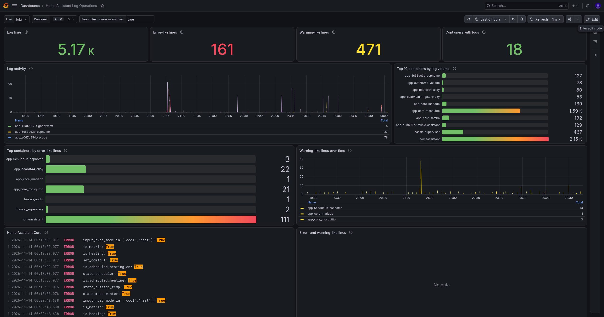

# Grafana Alloy – Home Assistant Add-on

<p align="center">
  
</p>

<p align="center">
  
  
</p>

<p align="center">
  <a href="https://my.home-assistant.io/redirect/supervisor_add_addon_repository/?repository_url=https%3A%2F%2Fgithub.com%2Fdockercraft-yt%2Fha-addon-alloy">
    
  </a>
</p>

Ship the logs of **Home Assistant Core, the Supervisor, the host and every installed add-on** to [Grafana Loki](https://grafana.com/docs/loki/) with [Grafana Alloy](https://grafana.com/docs/alloy/), running as a regular add-on on Home Assistant OS.

> This is an unofficial community add-on. It is not affiliated with or endorsed by Grafana Labs or Nabu Casa.

## Why this add-on?

- **Everything in one place:** Core, Supervisor, host and all add-on logs end up in Loki, searchable in Grafana.
- **Small and simple:** Based on the official `grafana/alloy` image. No extra privileges, no disabled protection mode, no Docker API access. The add-on only reads the host journal, read-only. It can also read the Home Assistant config and share folders, but only so you can load your own config file from there.
- **Configured from the Home Assistant UI:** Loki host and port, optional HTTPS and optional Basic Auth are plain add-on options.
- **Hackable:** Alloy's own web UI is available, and you can extend the default pipeline with your own `*.alloy` files or point the add-on to your own `config.alloy` anywhere in your Home Assistant config or share folder.
- **Example dashboard included:** Import it into Grafana and get log volume, errors and log streams per container.

## Requirements

- Home Assistant OS (add-ons require the Supervisor)
- A reachable Loki instance
- Grafana with a Loki data source (for the dashboard)

## Installation

1. Click the badge above, or go to **Settings → Add-ons → Add-on Store → ⋮ → Repositories** and add:

   ```
   https://github.com/dockercraft-yt/ha-addon-alloy
   ```

2. Install **Grafana Alloy** from the store.
3. Open the **Configuration** tab, enter your Loki host (and port if it is not `3100`) and save.
4. Start the add-on.

The add-on log should show `Sending logs to http://…`. A few seconds later the first entries appear in Grafana.

## Configuration

| Option | Required | Default | Description |
|---|---|---|---|
| `loki_host` | yes | – | IP or hostname of Loki, without `http://` and without port |
| `loki_port` | yes | `3100` | Port of Loki |
| `use_https` | no | `false` | Connect via HTTPS |
| `use_basic_auth` | no | `false` | Use Basic Auth |
| `loki_user` | with Basic Auth | – | Username |
| `loki_password` | with Basic Auth | – | Password |
| `custom_config_path` | no | – | Path to your own `config.alloy`, see [Custom Alloy configuration](#custom-alloy-configuration) |

Restart the add-on after changing options. HTTPS and Basic Auth are meant for setups with a reverse proxy in front of Loki, because Loki itself supports neither. See [DOCS.md](alloy/DOCS.md) for details.

## Finding your logs

Every entry carries `job="haos-journal"` plus the labels `container`, `syslog_identifier`, `unit` and `level`.

```logql
# Home Assistant Core
{job="haos-journal", container="homeassistant"}

# One add-on (container name is addon_<slug>)
{job="haos-journal", container="addon_core_ssh"}

# Errors across everything
{job="haos-journal"} |~ "ERROR|CRITICAL"
```

Use the label browser in Grafana Explore to see the container names on your system.

## Grafana dashboard

<p align="center">
  
</p>

An example dashboard lives in [`grafana/ha-logs-dashboard-v2.json`](grafana/ha-logs-dashboard-v2.json). It contains:

- Log-line counts and the number of containers with logs in the selected time range
- Log activity by container and warning-like lines over time
- Top containers by error-like lines and by log volume
- Log panels for all selected containers, Home Assistant Core, error-like lines, warning-like lines, and combined errors and warnings
- Variables for the Loki data source, a multi-select container filter, and free-text search (search applies to log panels only)

To import it: **Dashboards → New → Import → Upload JSON file**, then select your Loki data source.

Error- and warning-like lines are detected by case-insensitive, whole-word text matches (`ERROR`, `CRITICAL`, `WARNING`), not by an application severity label. The `level` label comes from the Docker journal driver and only reflects stdout versus stderr.

## Custom Alloy configuration

On first start, a default `config.alloy` is created in the add-on's config folder (`/addon_configs/<ID>_alloy/`, reachable via the Samba or SSH add-on). It is never overwritten by updates. All `*.alloy` files in that folder are loaded.

The `loki.write "default"` block is generated from the add-on options. Do not define it yourself, and forward your own pipelines to `loki.write.default.receiver`.

### Using your own config file

To keep your Alloy configuration somewhere else, enter its path in the `custom_config_path` option. The file then replaces the `config.alloy` from the add-on folder. Other `*.alloy` files in the add-on folder are still loaded, and the Loki output is still generated from the add-on options.

| Folder on Home Assistant | Path to enter | Example |
|---|---|---|
| Home Assistant config folder (with `configuration.yaml`) | `/homeassistant/...` | `/homeassistant/alloy/config.alloy` |
| Share folder | `/share/...` | `/share/alloy/config.alloy` |
| Add-on config folder | `/config/...` | `/config/my-config.alloy` |

Inside the add-on, `/config` is the add-on's own folder, not the Home Assistant config folder. For a file next to your `configuration.yaml`, use `/homeassistant/...`. Leave the option empty to go back to the default.

## Troubleshooting

- **The add-on runs but no logs arrive:** Make sure the `loki.source.journal` block in your `config.alloy` contains `path = "/var/log/journal"`. Without it, the journal can appear empty inside the container. You can check delivery with:

  ```
  curl -s http://<ADDON-HOSTNAME>:12345/metrics | grep loki_write_sent_entries_total
  ```

- **"component already declared":** Your own `.alloy` file defines `loki.write "default"`. Remove it.
- **"Custom Alloy config … not found or not readable":** The path in `custom_config_path` is wrong. Use `/homeassistant/...` for the Home Assistant config folder, not `/config/...`.
- **Certificate errors with HTTPS:** Self-signed certificates are currently not supported.

More in [DOCS.md](alloy/DOCS.md).

## Security notes

- The Alloy web UI on port 12345 has no login. Do not expose it to the internet.
- The Basic Auth password is stored in plain text in the add-on options, like every add-on option. It is not written to the log.
- The add-on mounts the Home Assistant config folder (including `secrets.yaml`) and the share folder read-only, so it can load a config file from `custom_config_path`. It does not read anything else from there.
- Home Assistant and add-on logs can contain sensitive data such as hostnames, IP addresses or tokens. Send them only to a Loki instance you trust.

## Repository layout

```
.
├── .github/workflows/
│   ├── build.yml      # builds and pushes the images to GHCR
│   ├── lint.yml       # add-on linter, ShellCheck, Hadolint, Alloy syntax
│   └── release.yml    # GitHub release from CHANGELOG.md
├── repository.yaml
├── README.md
├── img/               # logo and screenshots for the README
├── grafana/
│   └── ha-logs-dashboard-v2.json
└── alloy/
    ├── config.yaml
    ├── Dockerfile
    ├── run.sh
    ├── default.alloy
    ├── DOCS.md
    ├── DOCS.de.md     # German documentation
    ├── CHANGELOG.md
    └── translations/  # option names and descriptions in 12 languages
```

## Contributing

Issues and pull requests are welcome. Every pull request is linted and test-built automatically. To ship changes to the image, bump `version` in `alloy/config.yaml` and add a matching section to `alloy/CHANGELOG.md`; published image versions are never overwritten. When reporting a problem, please include the add-on log and your Home Assistant OS version, and remove any internal addresses or credentials first.

## License

See [LICENSE](LICENSE).
